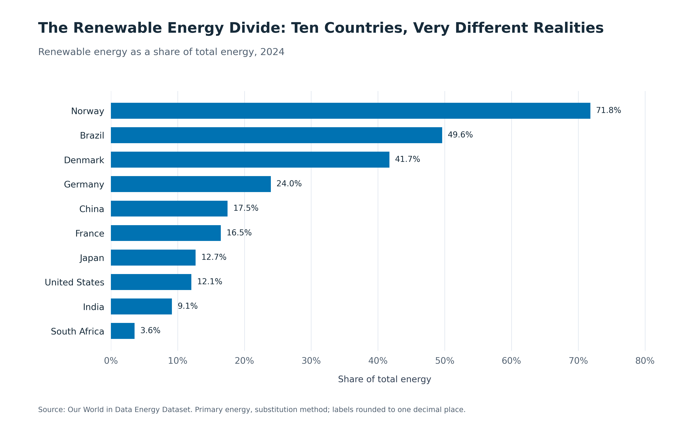
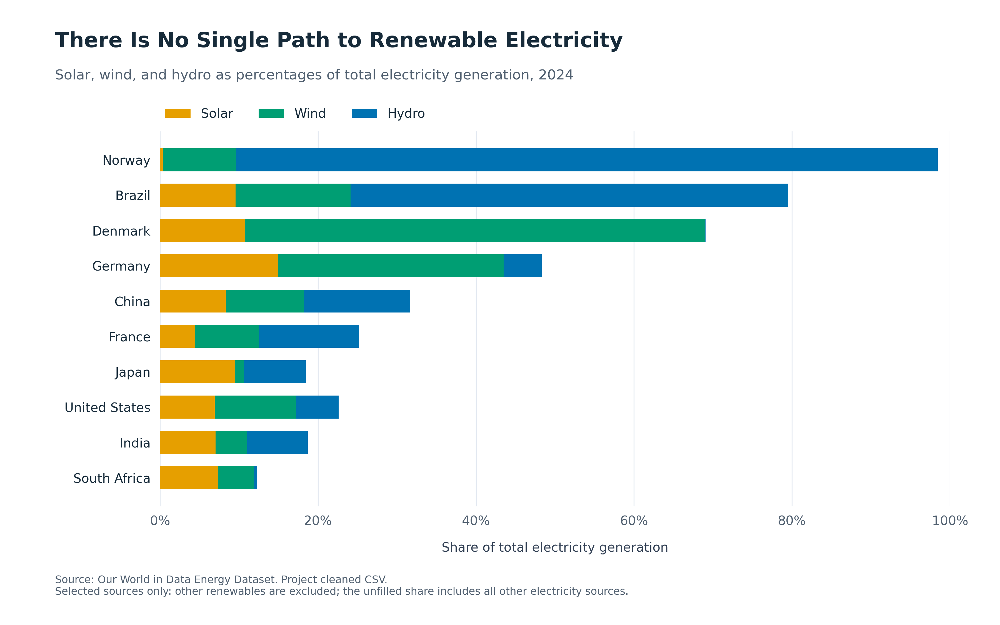
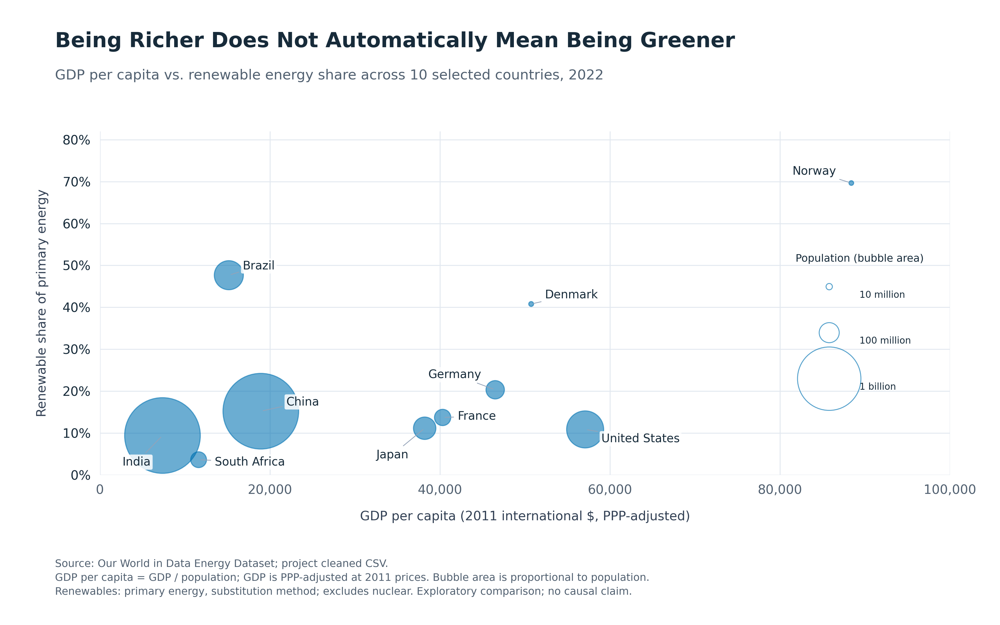
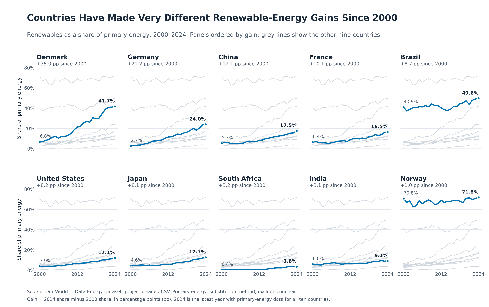

## The renewable transition is global — but far from equal {.opening background-color="#103D3B"}

::: {.opening-statement}
Renewable energy is expanding worldwide, but countries are progressing at very different levels and through very different pathways.
:::

::: {.notes}
Opening context for a general, non-expert audience. Use the original global renewable-energy map from the pitch once the asset is supplied, with its original source, denominator, and year. No map file is present in the repository; none has been fabricated or replaced with new analysis. Team: Aya Abdine, Meriam El Askri, Mcolisi Austine, Ghofran Mahmoud.
:::

## Why these 10 countries? {.country-slide}

::: {.lede}
We selected countries from different regions, with different economic sizes, populations, and renewable-energy systems, to compare contrasting transition pathways.
:::

::: {.country-grid}
::: {.country-card}
Germany
:::
::: {.country-card}
Denmark
:::
::: {.country-card}
Norway
:::
::: {.country-card}
France
:::
::: {.country-card}
China
:::
::: {.country-card}
United States
:::
::: {.country-card}
India
:::
::: {.country-card}
Brazil
:::
::: {.country-card}
Japan
:::
::: {.country-card}
South Africa
:::
:::

::: {.notes}
The ten countries were selected as deliberately contrasting national energy systems, not as a representative sample of the world. The card arrangement does not encode any data or ranking.
:::

## Renewable-energy shares vary dramatically {.chart-slide}

::: {.evidence-layout}
::: {.chart}

:::

::: {.observations}
**Norway** had the highest renewable share in this group in 2024.

**South Africa** had the lowest.
:::
:::

::: {.evidence-takeaway}
The gap shows how uneven renewable-energy adoption remains.
:::

::: {.chart-context}
Primary energy · 2024 · Source: Our World in Data Energy Dataset
:::

::: {.notes}
The existing chart is unchanged. Renewable share of primary energy uses the substitution method; it is not a final-energy or electricity share. These are sample-specific rankings, not world rankings. The chart describes adoption levels, not their causes.
:::

## But the ranking does not explain the system {.bridge .sources-bridge background-color="#103D3B"}

::: {.dominant-statement}
A high renewable share tells us how much renewable energy a country uses.
:::

::: {.bridge-support}
It does not tell us which renewable sources create that result.
:::

::: {.notes}
The next chart examines selected sources of electricity generation. Explain the denominator change from primary energy to electricity: the source chart is not a decomposition of the previous primary-energy indicator.
:::

## There is no single renewable-energy mix {.chart-slide}

::: {.evidence-layout}
::: {.chart}

:::

::: {.observations}
**Norway and Brazil:** strong hydropower contributions.

**Denmark:** wind stands out.

**Germany:** wind and solar contribute alongside a smaller hydro share.
:::
:::

::: {.evidence-takeaway}
Countries can reach high renewable electricity shares through very different mixes.
:::

::: {.chart-context}
Electricity generation · 2024 · Source: Our World in Data Energy Dataset
:::

::: {.notes}
The existing chart is unchanged. Shares use total electricity generation as the denominator. Solar, wind, and hydro exclude bioenergy and other renewables. Do not read these electricity shares as parts of the primary-energy shares in Visual 1. Germany's mix is not an equal balance of the three sources.
:::

## Being richer does not automatically mean being greener {.chart-slide}

::: {.evidence-layout}
::: {.chart}

:::

::: {.observations}
**Norway:** high income and a high renewable share.

**United States:** high income, much lower renewable share.

**Brazil:** relatively high renewable share at much lower income.
:::
:::

::: {.evidence-takeaway}
Economic wealth alone does not appear sufficient to explain renewable-energy leadership.
:::

::: {.chart-context}
Common year: 2022 · Association, not causation · Source: Our World in Data Energy Dataset
:::

::: {.notes}
The existing chart is unchanged. Use the latest complete common year, 2022. GDP per capita = GDP / population, in PPP-adjusted 2011 international dollars per person. Bubble area represents population. The observed sample suggests a positive overall association with substantial variation; do not imply no relationship or causal effects. 'Greener' refers to renewable share, not overall environmental performance. Renewables exclude nuclear, relevant to France. Income per person complements the total-GDP context in Milestone 2.
:::

## A snapshot is not enough {.bridge .time-bridge background-color="#103D3B"}

::: {.dominant-statement}
The 2024 ranking shows where countries stood — not how they got there.
:::

::: {.bridge-support}
Some started high. Others made large gains over the last two decades.
:::

::: {.notes}
Transition to observed changes since 2000. The adoption and source-mix charts use 2024; the income comparison uses 2022. Avoid describing the 2024 snapshot as current-year observations.
:::

## Countries have made very different gains since 2000 {.chart-slide}

::: {.evidence-layout}
::: {.chart}

:::

::: {.observations}
**Denmark** shows the largest increase, followed by **Germany**.

**Norway** changed much less and already had a very high share in 2000.
:::
:::

::: {.evidence-takeaway}
Current leadership can reflect long-standing strength or major progress over the observed period.
:::

::: {.chart-context}
Primary energy · 2000–2024 · Source: Our World in Data Energy Dataset
:::

::: {.notes}
The existing chart is unchanged. Cumulative gains are changes in percentage points from 2000 to 2024. Norway's high starting level and modest net gain are observed facts, not evidence identifying the cause of its trajectory. Distinguish adoption levels, starting points, and subsequent gains. Do not infer steady speed or acceleration from endpoint gains alone.
:::

## What may help explain these differences? {.context-slide}

::: {.context-grid}
::: {.context-card}
Natural resources and geography
:::
::: {.context-card}
Renewable technology mix
:::
::: {.context-card}
Economic context
:::
::: {.context-card}
Historical starting point
:::
::: {.context-card .wide-context}
National energy systems
:::
:::

::: {.context-caution}
These factors may help us interpret different pathways. Our comparison does not establish that they cause renewable adoption.
:::

::: {.notes}
These are possible interpretive factors, not tested explanations or new research findings. Source mix, economic context, and historical starting points are described by the existing visuals. Geography and national systems are contextual questions for discussion; no causal model or additional research has been added.
:::

## There is no single path to renewable energy {.conclusion}

::: {.insight-grid}
::: {.insight-card}
Different **shares**
:::
::: {.insight-card}
Different **energy mixes**
:::
::: {.insight-card}
Different **economic contexts**
:::
::: {.insight-card}
Different **trajectories over time**
:::
:::

::: {.conclusion-summary}
Renewable-energy leadership cannot be understood through one indicator alone.
:::

::: {.conclusion-detail}
Countries differ in their renewable share, the technologies they rely on, their economic context, and how much they have changed over time.
:::

::: {.notes}
Synthesize the four existing findings without ranking overall environmental performance or attributing causes. Main conclusion: Our comparison shows that renewable-energy leadership cannot be understood through one indicator alone. Countries differ in their renewable share, the technologies they rely on, their economic context, and how much they have changed over time.
:::

## Where we go next {.next-slide}

::: {.next-intro}
For the final project, we want to combine several dimensions into a country energy profile so the audience can compare multiple indicators at once.
:::

::: {.profile-diagram role="img" aria-label="Conceptual country energy profile connecting renewable share, solar, wind, hydropower, electricity generation, GDP, and population. No data values are encoded."}
::: {.profile-inputs}
::: {.indicator}
Renewable-energy share
:::
::: {.indicator}
Solar
:::
::: {.indicator}
Wind
:::
::: {.indicator}
Hydropower
:::
:::

::: {.profile-core}
**Country**\
energy profile

[Concept only]{.concept-label}
:::

::: {.profile-inputs .profile-context}
::: {.indicator}
Electricity generation
:::
::: {.indicator}
GDP
:::
::: {.indicator}
Population
:::
:::
:::

::: {.design-challenge}
The challenge is to create a visually rich comparison without sacrificing readability.
:::

::: {.notes}
Temporary development slide. This conceptual diagram shows possible inputs to a future 3D country-profile visualization; it is not an analytical visualization and encodes no country values, axes, scales, or rankings. No final 3D design has been developed. Preserve units and distinguish primary-energy and electricity measures when exploring the idea later.
:::
